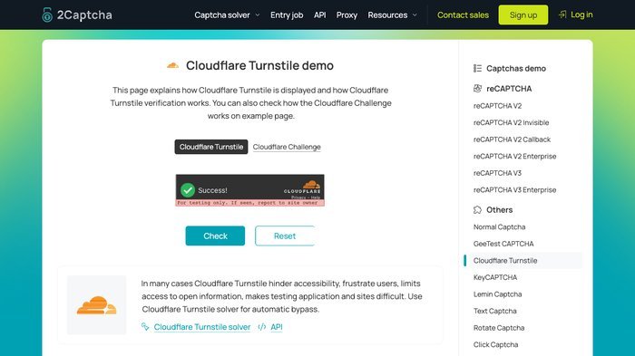
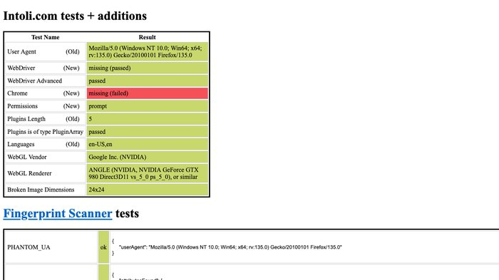
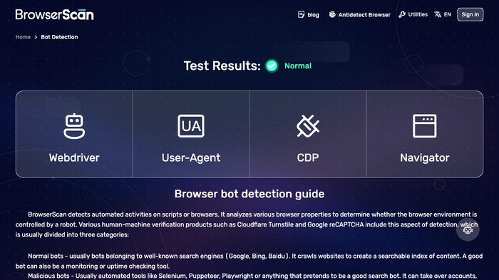

<div align="center">


# MCP Camoufox

An MCP server with 135 tools that gives an AI agent a Camoufox browser and an HTTP client with Firefox's TLS fingerprint.

[](https://www.npmjs.com/package/mcp-camoufox)
[](https://www.npmjs.com/package/mcp-camoufox)
[](https://opensource.org/licenses/MIT)
[](https://nodejs.org)

</div>

[Camoufox](https://github.com/daijro/camoufox) is a Firefox build that spoofs its fingerprint in C++ rather than through injected JavaScript. This server drives it with Playwright over Juggler, Firefox's automation protocol. Requests that need no browser go through [impit](https://github.com/apify/impit), which presents a Firefox TLS fingerprint.

Use the browser when a page needs JavaScript, a login or a person looking at it. Use HTTP when you only need the data.

- ✅ Camoufox with its fingerprint spoofing, driven over Juggler instead of CDP
- ✅ HTTP with a Firefox TLS fingerprint, reusing the browser's cookies when you want
- ✅ Replies that say what happened: a click reports whether the page changed, navigated or opened a tab
- ✅ Passwords, cookies and tokens hidden from tool output by default
- ✅ Logins kept in a persistent profile, or a temporary profile for one-off sessions
- ✅ Search through an endpoint you control (SearXNG, Brave, Tavily, Exa), with no result-page scraping
- ✅ Works with Claude Code, Cursor, Codex, Gemini CLI, OpenCode, Droid and other MCP clients

## Install

You need Node.js 18 or newer. The Camoufox browser downloads itself on first launch, which takes a few minutes and about 700 MB of disk.

Add the server to your client. Open the one you use:

<details>
<summary><b>Claude Code</b></summary>

All projects:

```bash
claude mcp add camoufox --scope user -- npx -y mcp-camoufox@latest
```

Current project only:

```bash
claude mcp add camoufox -- npx -y mcp-camoufox@latest
```
</details>

<details>
<summary><b>Claude Desktop</b></summary>

Edit the config file, then restart the app:

- macOS: `~/Library/Application Support/Claude/claude_desktop_config.json`
- Windows: `%APPDATA%\Claude\claude_desktop_config.json`
- Linux: `~/.config/Claude/claude_desktop_config.json`

```json
{
  "mcpServers": {
    "camoufox": {
      "command": "npx",
      "args": ["-y", "mcp-camoufox@latest"]
    }
  }
}
```
</details>

<details>
<summary><b>Cursor</b></summary>

Use `~/.cursor/mcp.json` for all projects, or `.cursor/mcp.json` in one project:

```json
{
  "mcpServers": {
    "camoufox": {
      "command": "npx",
      "args": ["-y", "mcp-camoufox@latest"]
    }
  }
}
```
</details>

<details>
<summary><b>Windsurf</b></summary>

Use `~/.windsurf/mcp.json` for all projects, or `.windsurf/mcp.json` in one project:

```json
{
  "servers": {
    "camoufox": {
      "command": "npx",
      "args": ["-y", "mcp-camoufox@latest"]
    }
  }
}
```
</details>

<details>
<summary><b>VS Code (Continue, Cline, Kilo Code)</b></summary>

Use your VS Code settings or `~/.continue/config.json` for all projects, or `.vscode/mcp.json` in one project:

```json
{
  "mcpServers": {
    "camoufox": {
      "command": "npx",
      "args": ["-y", "mcp-camoufox@latest"]
    }
  }
}
```
</details>

<details>
<summary><b>Zed</b></summary>

Edit `~/.config/zed/settings.json`:

```json
{
  "context_servers": {
    "camoufox": {
      "command": {
        "path": "npx",
        "args": ["-y", "mcp-camoufox@latest"]
      }
    }
  }
}
```
</details>

<details>
<summary><b>Codex CLI</b></summary>

Add to `~/.codex/config.toml`:

```toml
[mcp_servers.camoufox]
command = "npx"
args = ["-y", "mcp-camoufox@latest"]
```
</details>

<details>
<summary><b>Gemini CLI</b></summary>

Add to `~/.gemini/settings.json`:

```json
{
  "mcpServers": {
    "camoufox": {
      "command": "npx",
      "args": ["-y", "mcp-camoufox@latest"]
    }
  }
}
```
</details>

<details>
<summary><b>OpenCode</b></summary>

Add to `~/.config/opencode/opencode.json`:

```json
{
  "mcp": {
    "camoufox": {
      "type": "local",
      "command": ["npx", "-y", "mcp-camoufox@latest"],
      "enabled": true
    }
  }
}
```
</details>

<details>
<summary><b>Factory Droid</b></summary>

Add to `~/.factory/mcp.json`:

```json
{
  "mcpServers": {
    "camoufox": {
      "type": "stdio",
      "command": "npx",
      "args": ["-y", "mcp-camoufox@latest"]
    }
  }
}
```
</details>

<details>
<summary><b>Antigravity</b></summary>

Add to `~/.gemini/antigravity/mcp_config.json`:

```json
{
  "mcpServers": {
    "camoufox": {
      "command": "npx",
      "args": ["-y", "mcp-camoufox@latest"]
    }
  }
}
```
</details>

<details>
<summary><b>Trae</b></summary>

Add to `~/.trae/mcp.json`. Here `mcpServers` is an array:

```json
{
  "mcpServers": [
    { "name": "camoufox", "command": ["npx", "-y", "mcp-camoufox@latest"] }
  ]
}
```
</details>

On Windows the browser goes to `%LOCALAPPDATA%\camoufox` and the data to `%USERPROFILE%\.camoufox-mcp\`. Output paths accept `C:\path\file.json` and `C:/path/file.json`.

## Usage examples

An agent usually reads the page, then acts on the refs it got back:

```
browser_launch(url="https://example.com")
browser_snapshot()
click(ref="e3")
fill(ref="e5", value="hello")
```

Read a page without starting a browser. `smart_fetch` only uses the browser if the response looks blocked and one is running:

```
scrape_markdown(url="https://example.com/docs")
smart_fetch(url="https://shop.example.com/item/42")
```

Log in with the browser, then call the site's API over HTTP with the same cookies:

```
browser_launch(url="https://app.example.com/login", headless=false)
smart_fill(fields_json='{"Email":"me@example.com","Password":"..."}', submit_label="Sign in")
wait_for_change()
http_request(url="https://app.example.com/api/orders")
```

Find out why a click did nothing, before spending the click:

```
assert_clickable(selector="#submit")
# FAIL: covered by div.overlay
```

Run a sequence in one call. A failed step stops it and tells you where to resume:

```
workflow_run(steps=[
  {tool: "navigate", args: {url: "https://example.com"}},
  {tool: "smart_fill", args: {fields_json: '{"Search":"camoufox"}'}},
  {tool: "click_text", args: {text: "Search"}},
  {tool: "wait_for_change", args: {}}
])
```

Search through an endpoint you control:

```
search(query="firefox tls fingerprint", endpoint="http://127.0.0.1:8899")
```

## Test results

These come from the screenshots below, taken when each was captured. Sites and detectors change, so read them as what was observed and not as a guarantee. A pass on a test page does not mean a given protected site will let you in: IP reputation and session history count too.

| Site | What it checks | Result |
|------|----------------|--------|
| `bot.sannysoft.com` | Fingerprint tests | ✅ Passes, apart from the expected "Chrome missing" |
| `browserscan.net/bot-detection` | WebDriver, User-Agent, CDP, Navigator | ✅ All four "Normal" |
| `2captcha.com/demo/cloudflare-turnstile` | Turnstile widget, with Cloudflare's test key | ✅ Widget reaches "Success!" |
| `nopecha.com/demo/cloudflare` | Full-page "Just a moment..." challenge | ⚠️ Playwright click rejected, 0 of 3. Real OS cursor click passed, 2 of 2, on macOS from one machine and IP |

### Cloudflare Turnstile



The widget shows "For testing only": this demo uses Cloudflare's test sitekey and returns a dummy token. It shows that the click lands on the widget. It does not show that a protected site lets you through.

`click_turnstile` reports what it observed after the click: whether a token appeared, the final title and URL, whether a challenge still shows, and whether the sitekey is a Cloudflare test key. A click that produced no token is an error. A `cf_clearance` cookie on its own is not proof of passing either.

A Playwright click carries `mozInputSource=0` and an empty `pointerType`, and a real challenge can reject that. `turnstile_coords` followed by `os_click_xy` delivers a real OS cursor click instead, as two separate calls, in a headed browser. macOS is tested, with its Accessibility permission. The Windows and Linux paths are written but not tested. It moves your actual cursor and brings the window forward, so it will interrupt what you are doing on that machine.

### bot.sannysoft.com



`navigator.webdriver` is missing and WebDriver Advanced passes. The one red row is "Chrome missing", which is correct for a browser presenting itself as Firefox.

### browserscan.net



WebDriver, User-Agent, CDP and Navigator all read "Normal".

## Tools

135 tools in 32 groups. [docs/TOOLS.md](docs/TOOLS.md) lists every tool and parameter, and a test fails if that list or this page stops matching the running server.

<details>
<summary><b>Browser and navigation</b></summary>

| Group | Tools | For example |
|-------|-------|-------------|
| Browser Lifecycle | 4 | `browser_launch`, `browser_close`, `reset_profile` |
| Navigation | 4 | `navigate`, `go_back`, `go_forward`, `reload` |
| Tabs | 4 | `tab_list`, `tab_new`, `tab_select`, `tab_close` |
| Viewport | 2 | `get_viewport_size`, `set_viewport_size` |
| Scroll | 2 | `scroll`, `scroll_to` |
| Frames | 2 | `list_frames`, `frame_evaluate` |
</details>

<details>
<summary><b>Reading a page</b></summary>

| Group | Tools | For example |
|-------|-------|-------------|
| DOM &amp; Content | 7 | `browser_snapshot`, `screenshot`, `get_text` |
| Element Inspection | 5 | `inspect_element`, `get_attribute`, `query_selector_all` |
| Accessibility | 1 | `accessibility_snapshot` |
| Smart Selectors | 3 | `find_by_text`, `find_by_label`, `find_by_placeholder` |
| Scraping &amp; Extraction | 4 | `detect_content_pattern`, `extract_structured`, `extract_table` |
</details>

<details>
<summary><b>Acting on a page</b></summary>

| Group | Tools | For example |
|-------|-------|-------------|
| Element Interaction | 12 | `click`, `click_text`, `fill`, `select_option` |
| Keyboard | 2 | `type_text`, `press_key` |
| Mouse XY | 6 | `mouse_click_xy`, `click_turnstile`, `os_click_xy` |
| Humanize / Anti-Bot | 5 | `humanize_click`, `humanize_type`, `mouse_drift` |
| Dialog | 2 | `dialog_handle`, `dialog_auto_handle` |
| Batch Operations | 6 | `batch_actions`, `fill_form`, `login_classic` |
| Compound | 4 | `wait_and_snapshot`, `click_and_snapshot`, `back_and_snapshot` |
| Workflow Helpers | 3 | `click_and_wait`, `wait_for_network_idle`, `describe_page` |
| Wait | 7 | `wait_for`, `wait_for_url`, `wait_for_any_of` |
| JavaScript | 2 | `evaluate`, `inject_init_script` |
| Assertions | 4 | `assert_element_visible`, `assert_text_present`, `assert_url_matches` |
</details>

<details>
<summary><b>Sessions and storage</b></summary>

| Group | Tools | For example |
|-------|-------|-------------|
| Cookies | 3 | `cookie_list`, `cookie_set`, `cookie_delete` |
| Local Storage | 3 | `localstorage_get`, `localstorage_set`, `localstorage_clear` |
| Session Storage | 3 | `sessionstorage_get`, `sessionstorage_set`, `sessionstorage_clear` |
| Session Portability | 7 | `storage_state_save`, `auth_capture`, `cookie_export_file` |
| Storage Inspection | 4 | `storage_snapshot`, `storage_diff`, `indexeddb_list` |
| Session Warmup &amp; Detection | 2 | `session_warmup`, `detect_anti_bot` |
</details>

<details>
<summary><b>Network and HTTP</b></summary>

| Group | Tools | For example |
|-------|-------|-------------|
| Console &amp; Network | 9 | `network_start`, `network_get_detail`, `intercept_start`, `export_curl` |
| Browserless HTTP | 5 | `http_request`, `scrape_markdown`, `smart_fetch`, `search` |
| Debug | 6 | `server_status`, `get_page_errors`, `export_har`, `fingerprint_audit` |
| Site Automation | 2 | `chatgpt_generate_image`, `chatgpt_generate_batch` |
</details>

## Main features

<details>
<summary><b>Replies that match what happened</b></summary>

- A click reports what the page did: navigated, changed, opened a tab, or nothing within a second.
- A click on a disabled or hidden element is refused. A left click blocked by a covering element falls back to synthetic pointer events, names what covered it, and is an error if nothing then changed.
- A blocked right or double click is refused. It is never replayed as a left click.
- `click_text` and `click_role` refuse to guess between several matches and list them.
- A dialog that appears during any call is named in that call's reply, with how it was answered.
- `fill_form` stops at a failed field and does not submit. `batch_actions` stops at the first failure by default. A failed `fill` leaves the field's old value in place.
- `browser_close` checks that the process is gone. On Windows it cannot check, and says so.
- A call that cannot finish answers within its deadline instead of hanging.
</details>

<details>
<summary><b>Credentials in output</b></summary>

Cookie values, `Authorization`, `Set-Cookie`, passwords and tokens are masked by default in `network_get`, `network_get_detail`, `wait_for_request`, `wait_for_response`, `intercept_log`, `export_curl`, `export_har`, `http_request`, `http_session_cookies`, `cookie_list`, `cookie_export`, `storage_diff`, `localstorage_get` and `sessionstorage_get`. This covers tokens in JSON bodies, form bodies and URL parameters such as `access_token`. Pass `reveal_values=true` when you need the real value.

Password and other secret fields are masked in `browser_snapshot`, `inspect_element`, `form_introspect`, `find_by_label`, `get_attribute`, `get_html`, `fill`, `type_text` and error messages. `reveal_values` does not apply to these.

The masking goes by field name and known token shapes, so a secret in free text under an ordinary name can still get through. `evaluate` returns what your script returns. `navigate`, `get_url` and `tab_list` show the page's URL as it is. Session files from `storage_state_save`, `auth_capture` and `cookie_export_file`, and HAR files, are written with mode 0600.
</details>

<details>
<summary><b>Profiles</b></summary>

| Path | Contents |
|------|----------|
| `~/.camoufox-mcp/profile/` | Default profile: cookies, localStorage, cache |
| `~/.camoufox-mcp/profile-fresh-*/` | Temporary profiles from `fresh_profile=true` |
| `~/.camoufox-mcp/screenshots/` | Screenshots and default HAR exports |
| `~/.camoufox-mcp/sessions/` | `auth_capture` files |

`browser_launch(fresh_profile=true)` uses a temporary profile, removed on `browser_close`. The server also removes it when the client disconnects, and the next launch removes one left by a crashed server. `reset_profile` deletes the default profile with its logins, so call it only when you mean that.

Session cookies die with the browser even in the persistent profile. Use `cookie_set(expires_days=30)` or `storage_state_save` to keep a login.
</details>

<details>
<summary><b>Fingerprint and viewport</b></summary>

Camoufox picks a spoofed screen per profile, and it can be smaller than the size you ask for. `browser_launch` then shrinks the viewport to fit and says so, because a viewport larger than its own screen is something a detector can read. `fingerprint_audit` prints what a page sees and flags contradictions. It checks consistency only. It cannot tell you whether a particular site will accept you.

A fixed viewport does not follow the OS window. Call `set_viewport_size` after resizing, or launch with `no_viewport=true`.
</details>

## Limits

- `save_pdf` cannot work here: Playwright generates PDFs only on Chromium. Use `screenshot(full_page=true)`.
- Firefox has no CDP, so there are no performance traces, coverage, heap snapshots or CPU and network throttling.
- `browser_snapshot` does not look inside iframes or shadow DOM. Use `list_frames` and `frame_evaluate`.
- CLS is unavailable, because Firefox does not implement `layout-shift`.
- Camoufox occasionally never commits a navigation. A 30-second timeout from `navigate` is usually this, and a retry works. `tab_new` retries by itself.
- No CAPTCHA solving. Use `headless=false` and solve it yourself.
- `npm audit` may flag `adm-zip` through `camoufox-js`. npm applies overrides only from the root project, so add `"overrides": { "adm-zip": "0.6.0" }` to your own `package.json` if your scanner requires it.

## Troubleshooting

| Problem | What to do |
|---------|------------|
| "Browser not running" | Call `browser_launch`. If the browser crashed, `server_status` says so under `last_exit`. |
| "The browser is running but every tab is closed" | Call `tab_new`, or `browser_launch` with a URL. |
| "A copy of Camoufox is already open" | Another browser is using the default profile. Close it, or launch with `fresh_profile=true`. |
| A click reports no page change | The page may react later, so try `wait_for_change`. `assert_clickable` shows whether something covers the element. |
| A ref stopped working | Refs belong to one snapshot. Call `browser_snapshot` again. |
| `browser_launch` fails with `setDefaultViewport ... isMobile` | You are on a version before 0.9.3. Upgrade. |
| A tool says it did not finish | The page may be wedged. `tab_new` opens a fresh tab; `browser_recover` resets the session. |
| I cannot see the browser window | `headless=true` is the default and opens none. With `headless=false` the window opens behind your current app so it does not take your keyboard. Switch to it from the Dock or task bar. |

## How it works

```
AI agent
   |  MCP over stdio
   v
mcp-camoufox (Node.js) ---- impit (Firefox TLS) ---> HTTP requests with no browser
   |  Playwright over Juggler
   v
Camoufox (patched Firefox)
```

`browser_snapshot` tags elements with `data-mcp-ref` attributes and returns a short list of them, so an agent can act by ref instead of reading the whole page. A page's own scripts can see those attributes.

## Related

[mcp-stealth-chrome](https://github.com/RobithYusuf/mcp-stealth-chrome) is the sister project: the same idea for a real Chrome over CDP, in Python.

## License

MIT
